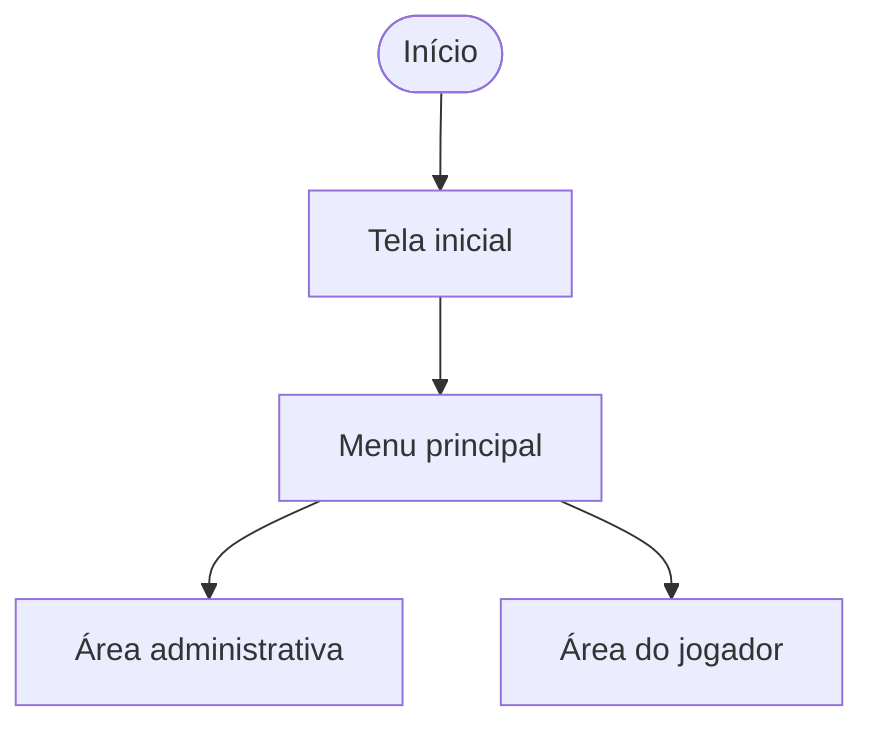
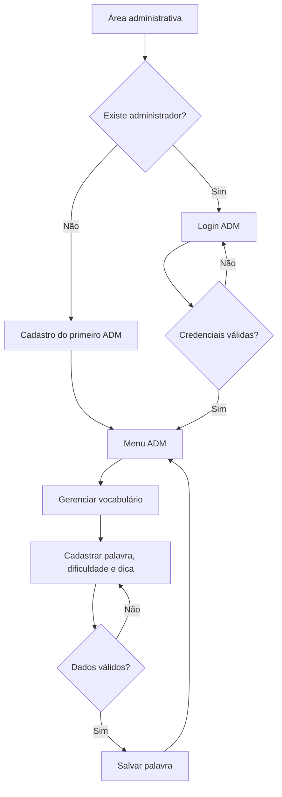
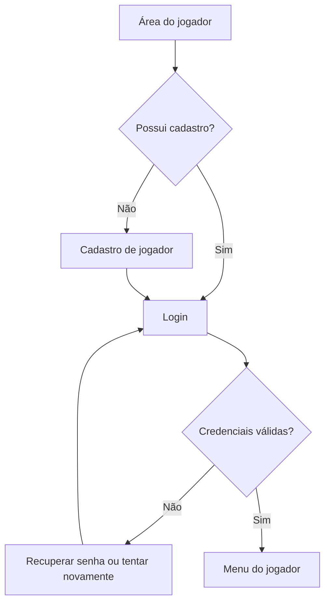
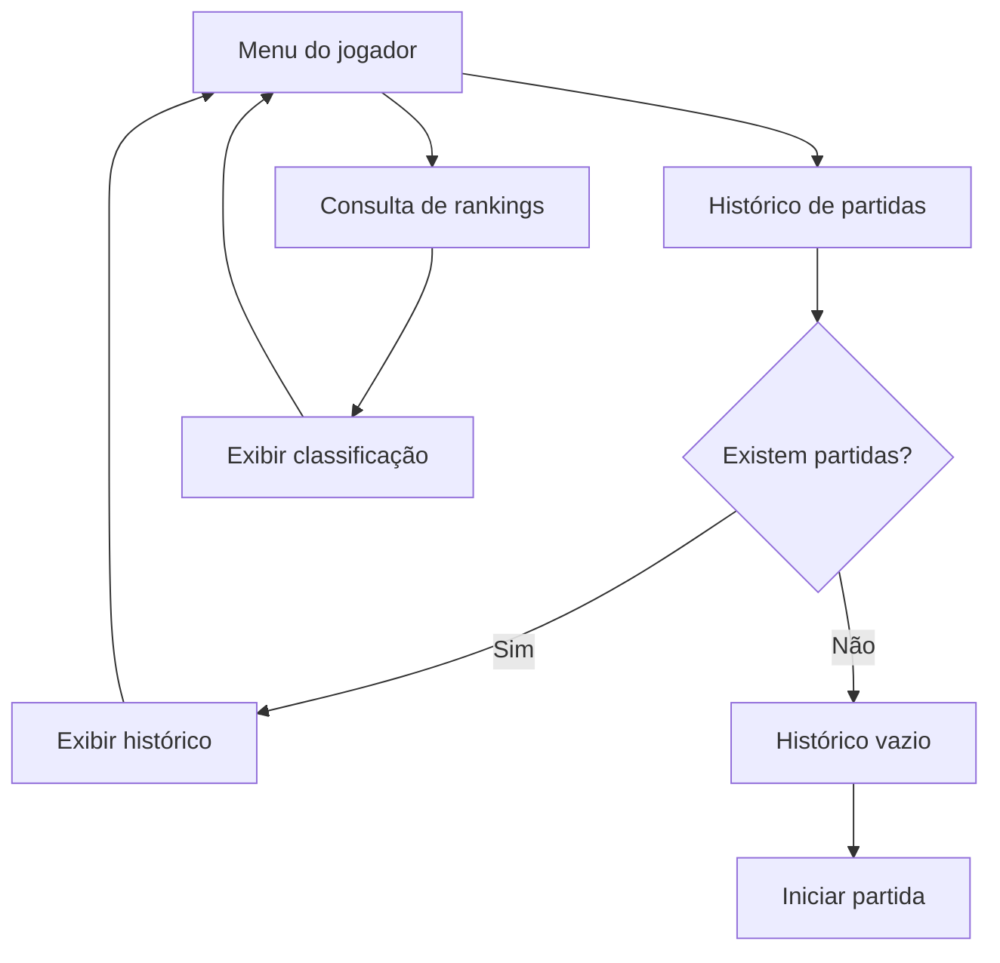
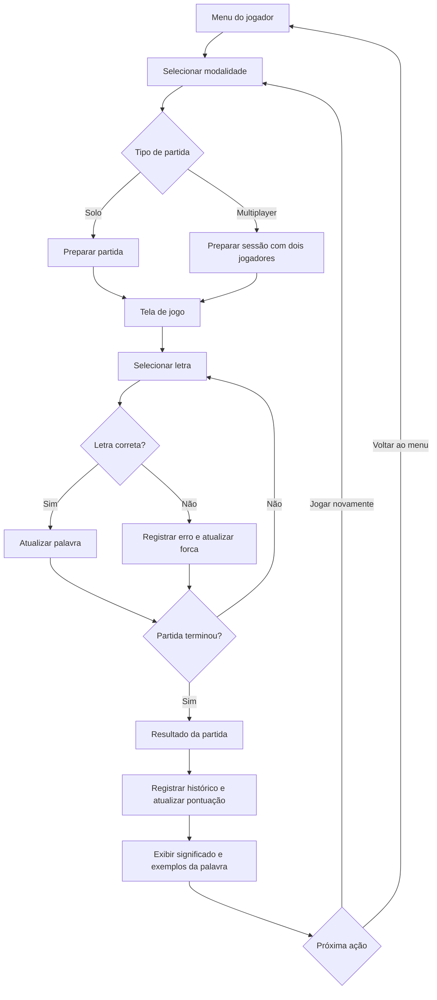
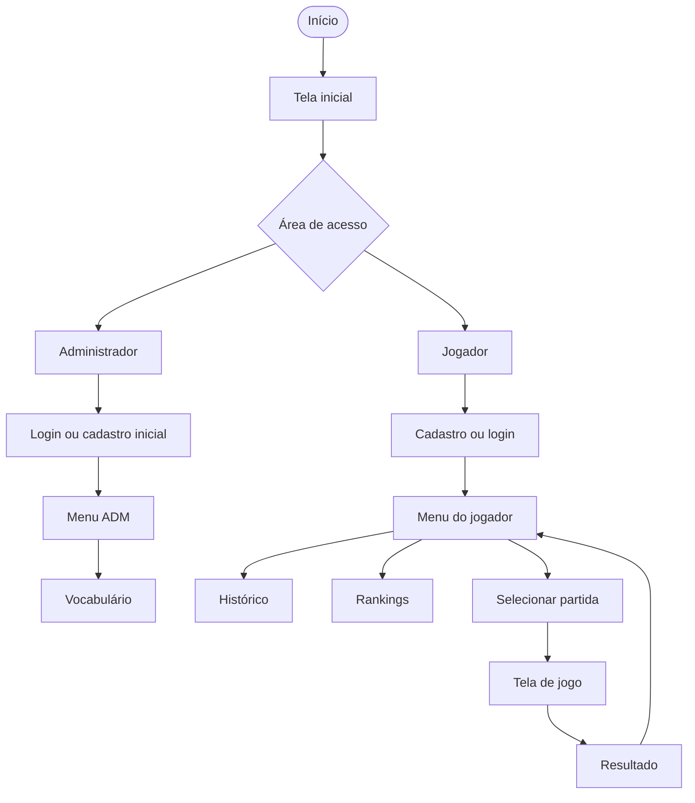

# Documento de acompanhamento de Atividades

O documento tem como objetivo servir como um mapa, a fim de identificar as tarefas desenvolvidas e os processos atuais no desenvolvimento do projeto

## Sprint 1

### Enquete de acompanhamento de protótipos já feitos

Selecione uma ou mais opções.

| Seleção | Tarefa |
|---|---|
| [ x ] | Login - Tela de Login |
| [ x ] | Login - Recuperar senha |
| [ x ] | Login - Cadastro do primeiro Adm |
| [ x ] | Menu - jogador |
| [ x ] | Menu - Adm |
| [ x ] | Histórico de partidas |
| [ x ] | Consulta de Ranquês |
| [ x ] | Jogar Sozinho ou para dois |
| [ x ] | ADM - Atualizar vocabulário |
| [ x ] | ADM - cadastrar jogador |
| [ x ] | Config: repositório github |
| [ x ] | Config: Relatório |
| [ x ] | Config: Fluxograma das Telas |

## Fluxo de Navegação das Telas — Jogo da Forca

### 1. Visão geral

O sistema está organizado em três áreas principais:

* **Inicial:** entrada e navegação principal.
* **Administrador:** autenticação e gerenciamento do vocabulário.
* **Jogador:** cadastro, autenticação, partidas, histórico e rankings.

---

### 2. Tela inicial

**Descrição:** ponto de entrada para acessar as funcionalidades do jogo.

---

### 3. Fluxo administrativo

**Descrição:** permite autenticar o administrador e gerenciar o vocabulário.

#### Telas administrativas

| Tela               | Descrição                                         |
| ------------------ | ------------------------------------------------- |
| Login/Cadastro ADM | Autentica ou cadastra o primeiro administrador.   |
| Menu ADM           | Centraliza as funcionalidades administrativas.    |
| Vocabulário        | Permite cadastrar palavras, dificuldades e dicas. |

---

### 4. Fluxo do jogador

**Descrição:** permite criar uma conta, entrar no sistema e acessar as funcionalidades individuais.

#### Telas do jogador

| Tela            | Descrição                                   |
| --------------- | ------------------------------------------- |
| Cadastro        | Cria uma conta de jogador.                  |
| Login           | Autentica o jogador.                        |
| Recuperar senha | Inicia o processo de recuperação de acesso. |
| Menu do jogador | Apresenta as funcionalidades disponíveis.   |

---

### 5. Histórico e rankings

**Descrição:** permite consultar partidas anteriores e classificações.

#### Telas de consulta

| Tela      | Descrição                                   |
| --------- | ------------------------------------------- |
| Histórico | Exibe as partidas registradas pelo jogador. |
| Rankings  | Apresenta as classificações e pontuações.   |

---

### 6. Fluxo de jogo

**Descrição:** permite escolher a modalidade, jogar e visualizar o resultado.

#### Telas do jogo

| Tela               | Descrição                                             |
| ------------------ | ----------------------------------------------------- |
| Seleção de partida | Permite escolher entre solo e multiplayer.            |
| Jogo               | Apresenta a palavra, a dica e as tentativas.          |
| Resultado          | Exibe o desfecho e informações educativas da palavra. |

---

## 7. Fluxo resumido do sistema

---

## 8. Regras essenciais

* O cadastro inicial de administrador só deve estar disponível quando não existir um administrador cadastrado.
* O login deve validar as credenciais antes de liberar o acesso.
* O vocabulário deve conter as informações necessárias para as partidas.
* O histórico deve apresentar registros ou informar quando estiver vazio.
* O ranking deve seguir os critérios de pontuação definidos pelo projeto.
* A partida deve terminar quando o jogador descobrir a palavra ou atingir o limite de erros.
* Ao finalizar a partida, o sistema deve registrar os dados necessários e apresentar o resultado.
* O acesso às funcionalidades deve respeitar o perfil do usuário.
