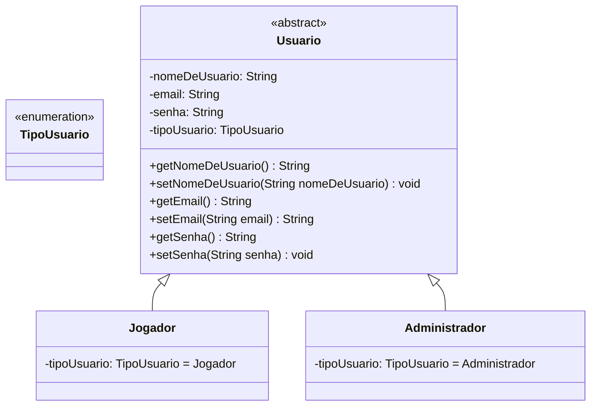

# Documento de acompanhamento de Atividades

O documento tem como objetivo servir como um mapa, a fim de identificar as tarefas desenvolvidas e os processos atuais no desenvolvimento do projeto

## Sprint 2

### Enquete de acompanhamento de protótipos já feitos

Selecione uma ou mais opções.

| Seleção | Tarefa |
|---|---|
| [   ] | Tela Login - HTML e CSS |
| [   ] | Cadastro 1º ADM - HTML e CSS |
| [   ] | Esqueceu a Senha - HTML e CSS |
| [   ] | Pagina Inicial - HTML e CSS |
| [   ] | Levantamento de Dados, Persistidos no Sistema |
| [   ] | Diagrama Entidade Relacionamento |
| [   ] | Relatório Sprint 2 |

## Dados Persistidos no Sistema

```mermaid
erDiagram

%% Susgestão - Tanto Jogador quanto Administrador são especializações de Usuário


Usuario {

    id_usuario INT PK "AUT"
    email VARCHAR(100) "NN, UQ"
    nome_de_usuario VARCHAR(100) "NN, UQ"
    senha VARCHAR(200) "NN"
    tipo_usuario VARCHAR(30) "NN"

}

    %% Tabela Auxiliar
    Usuario_Partida { 

        id_usuario INT PK, FK "NN"
        id_partida INT PK, FK "NN"

    }


Partida {
    id_partida INT PK "AUT"
    id_usuario INT FK "NN"
    id_tipo_partida INT FK "NN"
    qtd_pontos INT "NN"
}

    %% Tabela Auxiliar
    Partida_Vocabulario{

        id_partida INT PK, FK "NN"
        id_vocabulario INT PK, FK "NN"

    }

Vocabulario {

    id_vocabulario INT PK "AUT"
    palavra VARCHAR(30) "NN, UN"
    dificuldade INT "NN"
    dica TEXT 

}


Historico_De_Partida {

    id_historico INT PK "AUT"
    id_partida INT FK "NN"
    id_player INT FK "NN"
    id_adversario INT FK "NN"
    data_hora DATE "NN"
    
}

    %% Tabela Auxiliar
    Log_Historico_Processo {

        id_log_historico_processo INT PK "AUT"
        id_historico INT FK "NN"
        id_processo INT FK "NN"
        
    }

Processo {

    id_processo INT PK "AUT"
    nome_processo VARCHAR(100) "NN"
    descricao_processo TEXT

}


```

